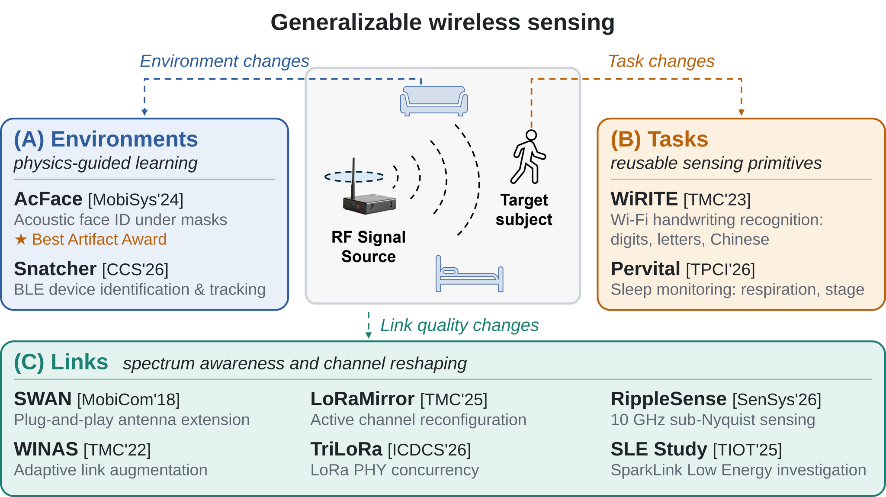

## About Me

I am currently a Post-doctoral Fellow at the Hong Kong University of Science and Technology (HKUST). Prior to this, I was a Postdoctoral Research Fellow at [Nanyang Technological University (NTU)](https://www.ntu.edu.sg/). I also worked as an AIoT Scientist and Co-Founder at [Better IoT Solutions Pte. Ltd. (Singapore)](https://www.better-iot.com.sg/), a startup focused on intelligent IoT solutions.
I received my Ph.D. in 2023 from the [College of Computing and Data Science (CCDS)](https://www.ntu.edu.sg/computing), NTU, under the supervision of [Professor Mo Li](https://cse.hkust.edu.hk/~lim/). Earlier, I earned my B.E. degree in 2017 from the [Harbin Institute of Technology (HIT)](https://www.hit.edu.cn/).
For more details, please refer to my [CV](./assets/files/CV/CV_main.pdf).

My research builds **generalizable wireless sensing systems** that provide reliable performance when the environment, the task, or the link quality changes. Specifically, I develop sensing frameworks that combine signal propagation physics with machine learning, and link enhancement techniques that keep the underlying wireless signals dependable. These systems perceive people and their surroundings through wireless signals, from activities (e.g., handwriting) and identity (e.g., face recognition) to physiological states (e.g., respiration, sleep), enabling applications such as indoor localization, user authentication, and smart healthcare. My research is full-stack and system-oriented, spanning radio hardware, signal processing, and learning algorithms, with an emphasis on prototypes that work in real-world deployments.

  

## Research Interests

- **Wireless sensing:** Contactless recognition, identification, and health monitoring using Wi-Fi, acoustic, and radar signals
- **Wireless link enhancement:** Spectrum awareness and channel reshaping for reliable data transmission in heterogeneous wireless networks

## News
- **[May 2025]** Our paper Snatcher is accepted to CCS 2026. Congratulations to Zhenyu!
- **[April 2025]** Our paper TriLoRa is accepted to ICDCS 2026! 
- **[October 2025]** Our paper RippleSense is accepted to SenSys 2026. Congratulations to Andreas!
- **[October 2025]** Our measurement study on Sparklink Low Energy (SLE) is accepted to ACM TIOT. Congratulations to Boya and Zhenyu!
- **[July 2025]** Our paper LoRaMirror is accepted to IEEE TMC. 
- **[April 2025]** I join [CSE, HKUST](https://cse.hkust.edu.hk/) as a Post-doctoral Fellow. 
- **[June 2024]** Our paper won the Best Artifact Award at MobiSys 2024! Check out the artifact: .
<!-- - **[May 2024]** I join [BITS](https://www.better-iot.com.sg/) as a Research Scientist.--> 
<!-- - **[May 2024]** We are awarded all four badges from MobiSys Artifact Evaluation. -->
<!-- - **[April 2024]** Our paper about acoustic facial recognition is accepted to MobiSys 2024. -->
<!-- - **[May 2023]** Commencing work as a Postdoctoral Research Fellow in SCSE, NTU. -->
<!-- - **[April 2023]** Our paper about general Wi-Fi handwriting recognition is accepted to IEEE TMC.  -->
<!-- - **[January 2023]** Successfully defending my Ph.D thesis.  -->




